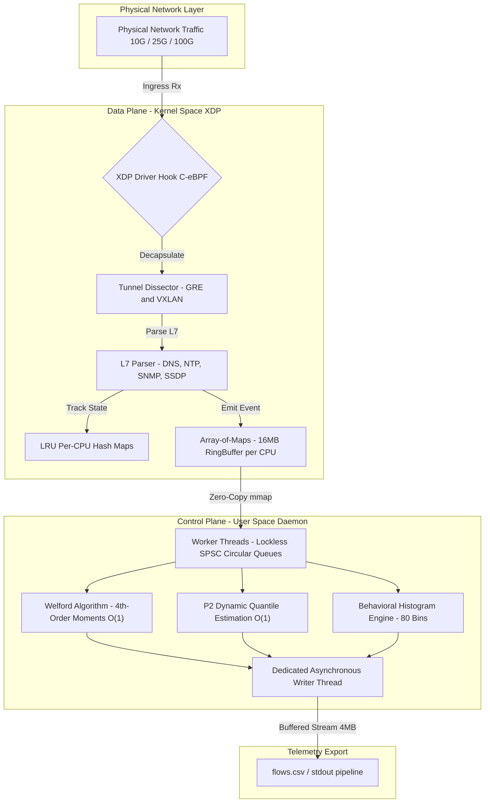

<div align="center">
    
    <h1>XFlowLyzer — [Experiment: Group 1 - Native Offline PCAP Ingestion]</h1>
    <i>High-Performance, Dual-Stack (IPv4/IPv6), Stateful Network Feature Extractor Powered by 100% C-eBPF/XDP.</i>
    <br>
    <b>Branch: <code>exp/group1-offline-pcap</code></b>
</div>

<br>

> [!IMPORTANT]
> **Scientific Reproducibility Artifact: Group 1 (Native Offline PCAP Ingestion)**
>
> This branch is an immutable experimental reproduction snapshot dedicated to evaluating **XFlowLyzer's Native In-Kernel PCAP Ingestion Engine** (`mmap` + `bpf_prog_test_run_opts`) against conventional user-space network feature extractors (**RustiFlow**, **NTLFlowLyzer**, **CICFlowMeter**, and **NetFeatureXtract / NFX**).
>
> For comprehensive hardware specifications, kernel memory layouts, testbed execution protocols, and mathematical validation proofs, **read the complete specification in [EXPERIMENT.md](EXPERIMENT.md)**.

---

## 🔬 Experimental Scope & Key Findings

Traditional network traffic extractors parse PCAP files in user-space via `libpcap` or socket loops, suffering from continuous context switching, packet memory copies, and dynamic heap fragmentation.

XFlowLyzer replaces user-space parsing with direct kernel ingestion:
* **In-Kernel Ingestion**: Maps raw packet frames directly into kernel memory via `mmap` and triggers the XDP driver verification sandbox directly using `bpf_prog_test_run_opts`.
* **Stationary Memory Allocation**: Locks flow state into stationary in-kernel `BPF_MAP_TYPE_LRU_PERCPU_HASH` maps, enforcing constant Resident Set Size (RSS).
* **Deterministic Line-Rate Processing**: Processes packets at physical memory bandwidth without garbage collection or interpreter overhead.

### Empirical Results (CIC-IDS-2017 30.06 GB Dataset - 46,872,693 Datagrams):
* **Execution Time**: Processed the full $30.06\,\text{GB}$ dataset in **$11.99\,\text{seconds}$** ($0$ memory stalls).
* **Sustained Throughput**: Achieved **$4.17\,\text{GB/s}$** ($\sim 33.36\,\text{Gbps}$ line rate).
* **Inspection Frequency**: Sustained **$1,933,151\,\text{PPS}$** ($\sim 1.93\,\text{Mpps}$) with **$100.0000\%$ retention** (zero drops).
* **Memory Footprint**: Stationary **$128.52\,\text{MB}$ RSS**, eliminating the memory bloating observed in tools like CICFlowMeter ($9.13\,\text{GB}$, OOM) and NTLFlowLyzer ($13.38\,\text{GB}$).

---

## ⚡ Quick Replication Command

To execute the automated evaluation harness against a local PCAP file:

```bash
# 1. Compile the XFlowLyzer engine
make clean && make -j$(nproc)

# 2. Run the automated N=10 comparative benchmark
sudo python3 scripts/bench_offline.py --pcap /path/to/capture.pcap --runs 10

# 3. Alternatively, run the testbed performance pipeline
sudo bash scripts/testbed/run_performance_test.sh /path/to/capture.pcap
```

---

## 📑 Detailed Documentation

All methodological parameters, hardware specifications, and comparative baselines are documented in:
* **[EXPERIMENT.md](EXPERIMENT.md)**: Full experimental specification, execution protocols, and hardware configurations.
* **[FEATURES.md](FEATURES.md)**: Full 495-feature telemetric specification.
* **[docs/knowledge/architecture.md](docs/knowledge/architecture.md)**: Mathematical models and systems design.
* **[docs/knowledge/gotchas.md](docs/knowledge/gotchas.md)**: Kernel and BPF verifier engineering notes.

---

## 🏛️ Architecture Blueprint



---

## 📜 License

Distributed under the **GNU General Public License v2.0 (GPL-2.0-only)**. See [LICENSE](LICENSE) for the full license text.
