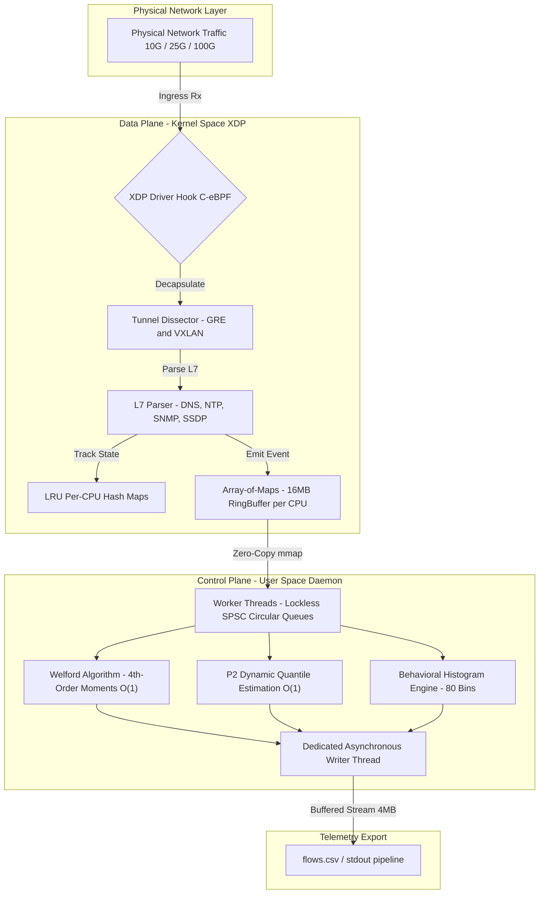

<div align="center">
    
    <h1>XFlowLyzer — [Experiment: Group 2 - Line-Rate Telemetry Retention]</h1>
    <i>High-Performance, Dual-Stack (IPv4/IPv6), Stateful Network Feature Extractor Powered by 100% C-eBPF/XDP.</i>
    <br>
    <b>Branch: <code>exp/group2-linerate-retention</code></b>
</div>

<br>

> [!IMPORTANT]
> **Scientific Reproducibility Artifact: Group 2 (Line-Rate Telemetry Retention)**
>
> This branch is an immutable experimental reproduction snapshot dedicated to evaluating **XFlowLyzer's Line-Rate Telemetry Retention and Memory Stationarity** against user-space network feature extractors (**CICFlowMeter**, **NTLFlowLyzer**, **ALFlowLyzer**) and kernel-space extractors (**RustiFlow**) under high-rate attack traffic (CICDDoS2019 / CIC-IDS-2017).
>
> For comprehensive hardware specifications, kernel memory layouts, testbed execution protocols, and mathematical validation proofs, **read the complete specification in [EXPERIMENT.md](EXPERIMENT.md)**.

---

## 🔬 Experimental Scope & Key Findings

Under multi-gigabit line-rate traffic, feature extraction architectures encounter diverging failure modes:
* **User-Space Memory Bloat**: Incurring unbounded heap allocations ($9.13\,\text{GB}$ to $13.38\,\text{GB}$), triggering the Linux OOM killer.
* **Kernel Traffic Control Contention**: Incurring global spinlock bottlenecks on `sk_buff` allocation, dropping up to $78\%$ of traffic before analysis.
* **XFlowLyzer XDP Driver Hook**: Locks flow states into stationary in-kernel `BPF_MAP_TYPE_LRU_PERCPU_HASH` maps ($128.52\,\text{MB}$ RSS) and maintains **$100.0000\%$ telemetry retention (zero drops)** at line rate.

---

## ⚡ Quick Replication Command

To execute the automated evaluation harness against an interface or capture:

```bash
# 1. Compile the XFlowLyzer engine
make clean && make -j$(nproc)

# 2. Run the automated N=10 line-rate retention benchmark
sudo python3 scripts/run_linerate_benchmark.py --target eth0 --runs 10

# 3. Alternatively, run the end-to-end classification pipeline
sudo bash scripts/run_cic_ids_2017_full_pipeline.sh /path/to/CIC-IDS-2017
```

---

## 📑 Detailed Documentation

All methodological parameters, hardware specifications, and comparative baselines are documented in:
* **[EXPERIMENT.md](EXPERIMENT.md)**: Full experimental specification, execution protocols, and hardware configurations.
* **[FEATURES.md](FEATURES.md)**: Full 495-feature telemetric specification.
* **[docs/knowledge/architecture.md](docs/knowledge/architecture.md)**: Mathematical models and systems design.
* **[docs/knowledge/gotchas.md](docs/knowledge/gotchas.md)**: Kernel and BPF verifier engineering notes.

---

## 🏛️ Architecture Blueprint



---

## 📜 License

Distributed under the **GNU General Public License v2.0 (GPL-2.0-only)**. See [LICENSE](LICENSE) for the full license text.
