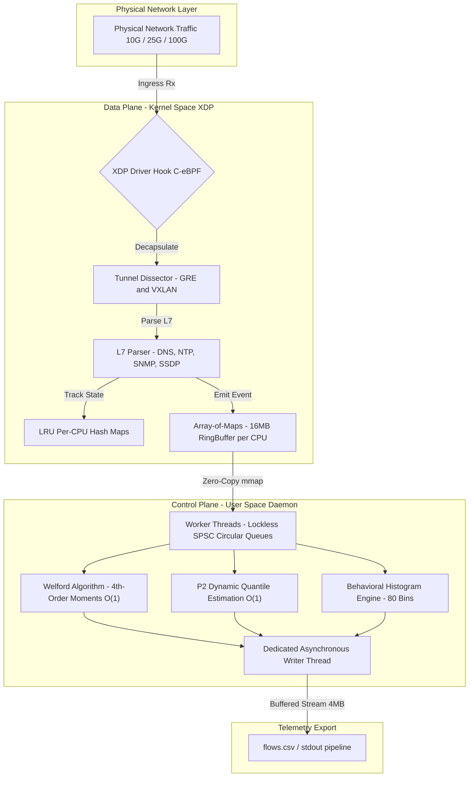

<div align="center">
    
    <h1>XFlowLyzer — [Experiment: Group 3 - Upper Bound Capacity Confrontation]</h1>
    <i>High-Performance, Dual-Stack (IPv4/IPv6), Stateful Network Feature Extractor Powered by 100% C-eBPF/XDP.</i>
    <br>
    <b>Branch: <code>exp/group3-upperbound-tc</code></b>
</div>

<br>

> [!IMPORTANT]
> **Scientific Reproducibility Artifact: Group 3 (Upper Bound Capacity & TC Contention)**
>
> This branch is an immutable experimental reproduction snapshot dedicated to evaluating **XFlowLyzer's Native Driver-Mode XDP Data Plane** against **RustiFlow's Linux Traffic Control (TC) Data Plane** under multi-threaded parallel stress across 48 SMP logical cores without replay bottleneck.
>
> For comprehensive hardware specifications, kernel spinlock bottleneck analyses, testbed execution protocols, and mathematical validation proofs, **read the complete specification in [EXPERIMENT.md](EXPERIMENT.md)**.

---

## 🔬 Experimental Scope & Key Findings

This experiment investigates physical capacity limits and event retention across two kernel architectures under multi-million packet per second (Mpps) injection:
* **RustiFlow (Traffic Control Hook)**: Intercepts packets after `sk_buff` memory allocation, causing atomic spinlock bottlenecks at rates above $2.51\,\text{Mpps}$ and dropping **$78.1402\%$** of critical events.
* **XFlowLyzer (Driver-Mode XDP Hook)**: Intercepts packets at the network driver before `sk_buff` allocation, executing lockless per-CPU aggregation at **$5.030.633\,\text{PPS}$** with **$0.0000\%$ event loss** ($100\%$ retention).

---

## ⚡ Quick Replication Command

To execute the automated evaluation harness against the isolated testbed:

```bash
# 1. Compile the XFlowLyzer engine
make clean && make -j$(nproc)

# 2. Run the automated N=10 upper bound capacity confrontation
sudo python3 scripts/bench_upper_bound.py --duration 10 --runs 10

# 3. Run the live in-kernel pktgen benchmark
sudo python3 scripts/bench_pktgen.py --duration 10 --runs 10
```

---

## 📑 Detailed Documentation

All methodological parameters, hardware specifications, and comparative baselines are documented in:
* **[EXPERIMENT.md](EXPERIMENT.md)**: Full experimental specification, execution protocols, and hardware configurations.
* **[FEATURES.md](FEATURES.md)**: Full 495-feature telemetric specification.
* **[docs/knowledge/architecture.md](docs/knowledge/architecture.md)**: Mathematical models and systems design.
* **[docs/knowledge/gotchas.md](docs/knowledge/gotchas.md)**: Kernel and BPF verifier engineering notes.

---

## 🏛️ Architecture Blueprint



---

## 📜 License

Distributed under the **GNU General Public License v2.0 (GPL-2.0-only)**. See [LICENSE](LICENSE) for the full license text.
