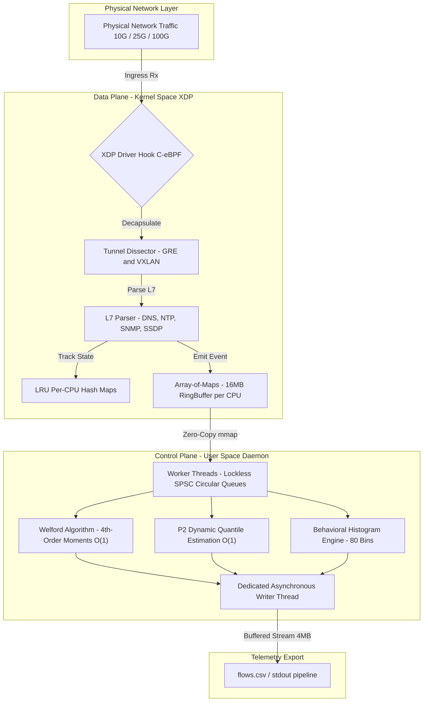

<div align="center">
    
    <h1>XFlowLyzer</h1>
    <i>High-Performance, Dual-Stack (IPv4/IPv6), Stateful Network Feature Extractor Powered by 100% C-eBPF/XDP.</i>
    <br>
    <b>Version: 1.0.0</b>
</div>

<br>

## 📌 Overview

**XFlowLyzer** is a high-performance, open-source stateful network traffic feature extractor and telemetry engine designed for line-rate monitoring across modern multi-gigabit (10G/25G/100G) infrastructure and data centers. 

To resolve the throughput bottlenecks, involuntary packet drops, and memory exhaustion common in traditional user-space extractors (such as CICFlowMeter, NTLFlowLyzer, and ALFlowLyzer) as well as the socket buffer (`sk_buff`) overhead of Linux Traffic Control (TC) hooks, XFlowLyzer unrolls extraction into a **100% End-to-End C Architecture**:
* **Data Plane (Kernel Space):** Operates at the lowest architectural level of the operating system via **eBPF/XDP** (eXpress Data Path) in native driver mode (`XDP_DRV`), executing deep packet inspection and state tracking directly within the NIC receive ring before kernel network stack allocation.
* **Control Plane (User Space):** A multi-threaded, lockless daemon in C utilizing **C11 Atomics** (`stdatomic.h`) and per-worker Single-Producer Single-Consumer (**SPSC**) circular queues, delivering zero thread contention and continuous serialization to CSV streams.

XFlowLyzer implements a **Unified Dual-Stack Engine** via IPv4-Mapped IPv6 address space, processing IPv4 and IPv6 traffic under an identical $O(1)$ statistical pipeline.

---

## 🎯 Key Architectural Capabilities

1. **Driver-Level Packet Interception (Native XDP)**: Intercepts raw Ethernet frames directly at the network interface card (NIC) driver layer before `sk_buff` allocation, bypassing the Linux network stack and memory bus contention.
2. **Lockless Multi-Core State Tracking (`LRU_PERCPU_HASH`)**: Stateful flow management utilizes strictly isolated per-CPU Hash Maps with passive Least Recently Used (LRU) eviction. This eliminates inter-core spinlocks and ensures absolute immunity to memory exhaustion during volumetric DDoS attacks.
3. **Contention-Free RingBuffer Array (`ARRAY_OF_MAPS`)**: Telemetry submission avoids shared global ring buffers. An array-of-maps hosts dedicated $16\,\text{MB}$ ring buffers per core, consumed by dedicated worker threads without cross-core cache invalidations.
4. **Iterative $O(1)$ Statistics via Welford's Algorithm**: Bidirectional flow metrics (Mean, Variance, Standard Deviation, Skewness, Kurtosis, and Inter-Arrival Times) are calculated online on the fly without retaining packet payload history in RAM.
5. **Online Quantile Estimation ($P^2$ Algorithm)**: Maintains dynamic percentile and median tracking in $O(1)$ time complexity for payload sizes, window sizes, and inter-arrival times.
6. **Native Tunnel Decapsulation (GRE & VXLAN)**: Performs recursive dissection of encapsulated overlay traffic directly in the fast-path, extracting inner IP flow tuples and capturing Tunnel IDs (GRE Keys / VXLAN VNIs).
7. **Deep Kernel-Space L7 Visibility**:
   * **DNS**: Native parser with support for pointer compression (`0xC0`) and label skipping. Extracts `QueryType`, `QueryClass`, and `AnswerCount`.
   * **NTP / SNMP / SSDP**: In-kernel inspection of NTP Mode/Stratum, SNMP PDU Types, and SSDP methods.
8. **Static RSS Memory Footprint**: Strictly constrained memory footprint ($128.52\,\text{MB}$ RSS), zero heap allocation in the hot path, and stationary operational stability ($\sigma^2_{RSS} = 0$).
9. **Dual Operational Modes**: Supports live line-rate capture on physical network interfaces and native offline PCAP validation via `mmap` and in-kernel `bpf_prog_test_run_opts`.
10. **Comprehensive Feature Suite**: Generates **495 telemetric attributes** per flow record, including 80-bin distribution histograms and sub-millisecond bidirectional timing profiles.

---

## 🏛️ Architecture Blueprint



---

## ⚙️ System Requirements & Prerequisites

* **Operating System**: Linux Kernel $\ge 6.1$ (Tested and validated on Linux $6.8+$).
* **Hardware Architecture**: `x86_64` multi-core symmetric multiprocessing (SMP).
* **Network Interfaces**:
  * Native Driver Mode (`XDP_DRV`): Mellanox ConnectX-5 / ConnectX-6 Dx ($100\,\text{GbE}$ `mlx5`), Intel `ixgbe` / `i40e` / `ice`.
  * Generic Mode (`XDP_SKB`): Any Linux-supported network interface or virtual ethernet (`veth`) pair.
* **Kernel Configuration Requirements**:
  * `CONFIG_BPF=y`
  * `CONFIG_BPF_SYSCALL=y`
  * `CONFIG_NET_CLS_ACT=y`
  * `CONFIG_DEBUG_INFO_BTF=y` (BPF Type Format / CO-RE)
* **Required Build Packages**:
  * `clang` ($\ge 14.0$), `llvm`, `libbpf-dev` ($\ge 1.2$), `libelf-dev`, `zlib1g-dev`, `libpcap-dev`, `make`.

---

## 🚀 Installation & Build

### 1. Clone the Repository
```bash
git clone https://github.com/leonardoherkenhoff/XFlowLyzer.git
cd XFlowLyzer
```

### 2. Compile the Pipeline
The Makefile compiles the eBPF Data Plane (`main.bpf.o`) via Clang BPF target and the User-Space Control Plane daemon (`xflowlyzer`):
```bash
make clean && make -j$(nproc)
```

The resulting binaries are placed in `build/`:
* `build/main.bpf.o`: Compiled eBPF/XDP bytecode.
* `build/xflowlyzer`: Multi-threaded Control Plane daemon.

---

## 💻 Usage & CLI Reference

XFlowLyzer operates via a clean, unified command-line interface.

### Mode 1: Live Interface Capture (Production Line-Rate)
Attaches XFlowLyzer directly to the specified interface in native driver mode (`XDP_DRV`):

```bash
# Capture live traffic on interface eth0 and stream 495-feature CSV to file
sudo ./build/xflowlyzer eth0 > flows.csv

# Capture with generic fallback (SKB mode) and set event limit
sudo ./build/xflowlyzer eth0 skb --limit 1000000 > flows.csv
```

### Mode 2: Native PCAP Ingestion (Offline High-Fidelity Validation)
Ingests offline PCAP files via `mmap` memory mapping and executes bytecode directly inside the kernel using `bpf_prog_test_run_opts`. This eliminates user-space interpreter overhead while validating kernel state:

```bash
# Ingest PCAP capture directly into kernel eBPF engine
sudo ./build/xflowlyzer --pcap /path/to/capture.pcap > output_flows.csv

# Ingest with limit of events
sudo ./build/xflowlyzer --pcap /path/to/capture.pcap --limit 5000000 > output_flows.csv
```

### Termination & Clean Telemetry Flush
Send `SIGINT` (`Ctrl+C`) or `SIGTERM`. XFlowLyzer intercepts the signal, detaches the XDP hook, performs synchronous draining of all per-CPU ring buffers for 2 seconds, and flushes all pending records with **0% telemetry loss**.

---

## 📊 Telemetry Feature Suite

XFlowLyzer exports an exhaustive **495-feature telemetric matrix**:
* **Flow Identifiers & Metadata (22 features):** 5-tuple, IP versions, MAC addresses, flow duration, packet/byte counters and ratios.
* **16 Statistical Metric Families (160 features):** Total/Fwd/Bwd Payload, Headers, Inter-Arrival Times (IAT), Delta Lengths, Window sizes, IP ID variance, and TTL variance across 10 moments (Max, Min, Mean, Std, Var, Median, Skewness, Kurtosis, CoV, Mode).
* **TCP Metrics & Flags (26 features):** Initial window bytes and counters for FIN, SYN, RST, PSH, ACK, URG, ECE, CWR flags (Total, Forward, Backward).
* **Entropy, TTL & ICMP Granularity (5 features):** Shannon payload entropy, ICMP Type/Code, IPv4 TTL, ICMP Echo ID.
* **Network Behavior & Rates (22 features):** Active/Idle times (20 statistical moments), Packet/Byte rates, Down/Up ratio, Bulk transfer metrics, and L7 telemetry (DNS queries/answers, NTP mode/stratum, SNMP PDU types, SSDP methods, Tunnel IDs).
* **Behavioral Distribution Histograms (240 features):** 80-bin histograms for Total, Forward, and Backward payload size distributions.

For the exhaustive dictionary, feature numbering, and mathematical formulas, consult [FEATURES.md](FEATURES.md).

---

## 📄 Documentation Index

* [FEATURES.md](FEATURES.md): Complete 495-Feature Specification & Dictionary.
* [docs/knowledge/architecture.md](docs/knowledge/architecture.md): Systems Architecture, Memory Guarantees & Math Specifications.
* [docs/knowledge/gotchas.md](docs/knowledge/gotchas.md): Kernel Engineering Gotchas, MTU Constraints & BPF Verifier Solutions.
* [docs/knowledge/csv_schema.md](docs/knowledge/csv_schema.md): CSV Export Schema & Header Definitions.
* [CHANGELOG.md](CHANGELOG.md): Project History & Release Notes.
* [CONTRIBUTING.md](CONTRIBUTING.md): Engineering Guidelines & PR Workflow via `develop`.
* [ROADMAP.md](ROADMAP.md): Post-Release Architectural Roadmap.

---

## 📜 License
 
Distributed under the **GNU General Public License v2.0 (GPL-2.0-only)**. Designed for high-performance network analysis, telemetry research, and community-driven kernel observability. See [LICENSE](LICENSE) for the full license text.
