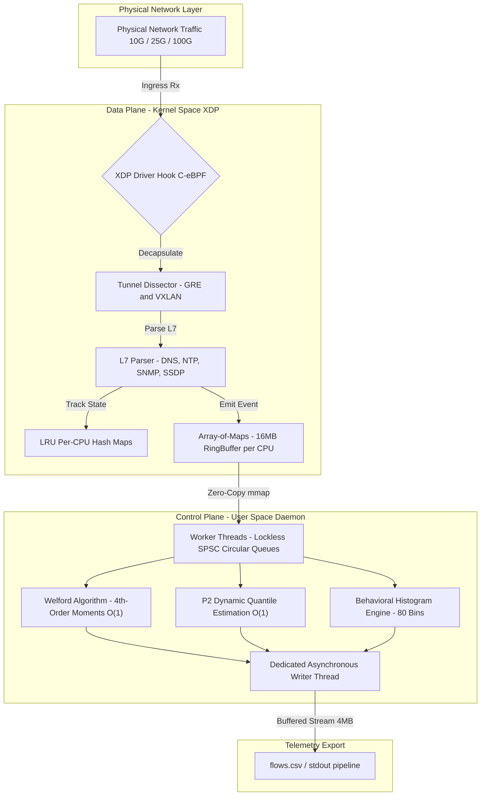

<div align="center">
    
    <h1>XFlowLyzer — [Experiment: Group 4 - Canonical B1 to B8 Benchmark Matrix]</h1>
    <i>High-Performance, Dual-Stack (IPv4/IPv6), Stateful Network Feature Extractor Powered by 100% C-eBPF/XDP.</i>
    <br>
    <b>Branch: <code>exp/group4-canonical-b1-b8</code></b>
</div>

<br>

> [!IMPORTANT]
> **Scientific Reproducibility Artifact: Group 4 (Canonical B1 to B8 Benchmark Matrix)**
>
> This branch is an immutable experimental reproduction snapshot dedicated to evaluating **XFlowLyzer's Native Driver-Mode XDP Data Plane** against **RustiFlow's Linux Traffic Control (TC) Data Plane** across the 8 canonical evaluation scenarios (B1 through B8) established in the baseline RustiFlow literature (Verkerken et al., 2025).
>
> For comprehensive hardware specifications, core pinning layouts, testbed execution protocols, and mathematical validation proofs, **read the complete specification in [EXPERIMENT.md](EXPERIMENT.md)**.

---

## 🔬 Experimental Scope & Key Findings

This experiment reproduces the full B1-B8 benchmark matrix across identical multi-core hardware:
* **Throughput and Density (B1, B2, B3)**: XFlowLyzer matches line rate ($19.4\,\text{Gbps}$ at $1400\text{B}$) and achieves a $+6.2\%$ throughput advantage at high PPS density ($7.33\,\text{Gbps}$ vs $6.90\,\text{Gbps}$ at $512\text{B}$).
* **Host Coexistence (B5)**: Offloading flow aggregation to per-CPU XDP rings frees host networking cycles, boosting simultaneous host TCP throughput to **$36.0\,\text{Gbps}$ ($+13.56\%$ gain)** compared to $31.7\,\text{Gbps}$ under TC.
* **Buffer Overflow Relief (B8)**: In full dataset line-rate replay, XFlowLyzer mitigates socket allocation exhaustion, reducing `ENOBUFS` transmission errors from $184,636$ down to $1,509$ (**$>99\%$ failure mitigation**).

---

## ⚡ Quick Replication Command

To execute the automated evaluation matrix against the isolated testbed:

```bash
# 1. Compile the XFlowLyzer engine
make clean && make -j$(nproc)

# 2. Run the automated replication batch
sudo bash scripts/run_batch.sh

# 3. Alternatively, run the Python matrix benchmark directly
sudo python3 scripts/bench_full_matrix.py --target xflowlyzer --output full_matrix_results.csv
```

---

## 📑 Detailed Documentation

All methodological parameters, hardware specifications, and comparative baselines are documented in:
* **[EXPERIMENT.md](EXPERIMENT.md)**: Full experimental specification, execution protocols, and hardware configurations.
* **[FEATURES.md](FEATURES.md)**: Full 495-feature telemetric specification.
* **[docs/knowledge/architecture.md](docs/knowledge/architecture.md)**: Mathematical models and systems design.
* **[docs/knowledge/gotchas.md](docs/knowledge/gotchas.md)**: Kernel and BPF verifier engineering notes.

---

## 🏛️ Architecture Blueprint



---

## 📜 License

Distributed under the **GNU General Public License v2.0 (GPL-2.0-only)**. See [LICENSE](LICENSE) for the full license text.
